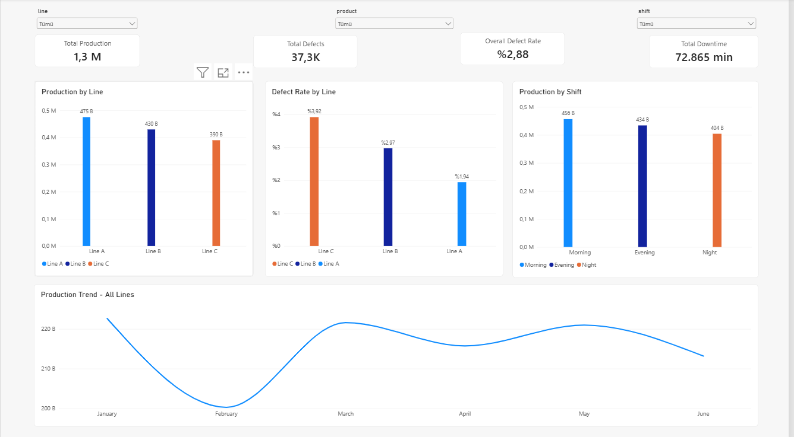
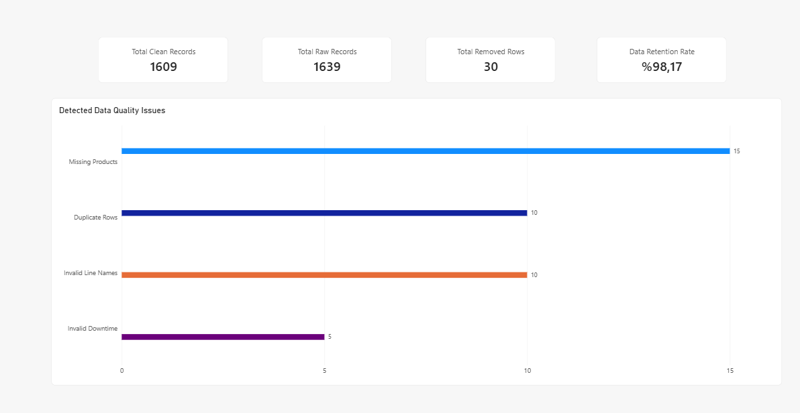

# Manufacturing & Quality Analytics

An end-to-end manufacturing data analytics project built using **Python, Excel, PostgreSQL and Power BI**.

## Project Overview

This project simulates manufacturing operations across multiple production lines, shifts, and products.

The objective is to analyze production performance, identify quality issues, and demonstrate an automated data-processing workflow.

The project uses synthetic manufacturing data generated with Python.

## Dashboards

### 1. Production Overview

This dashboard displays production performance across
manufacturing lines, shifts, and products.

### 2. Data Quality Analysis

This dashboard shows missing values, duplicate records,
invalid data, and the results of Python data cleaning.

## Technologies Used

- **Python (pandas):** Data generation, cleaning, validation, and database integration.
- **Excel:** Production analysis using SUMIFS, COUNTIFS, XLOOKUP, PivotTables, and charts.
- **PostgreSQL:** Data storage and analytical SQL views.
- **Power BI:** Interactive dashboards, DAX measures, and production performance analysis.

## Data Pipeline

1. Generate synthetic manufacturing records using Python.
2. Introduce and identify data-quality issues.
3. Clean and validate records using pandas.
4. Load processed data into PostgreSQL.
5. Analyze production and quality metrics using SQL.
6. Visualize production performance and data quality in Power BI.
7. Perform supplementary analysis in Excel.

## Dashboards

### Production Overview

Analyzes total production, defect rates, downtime, and performance across production lines, products, and shifts.

Includes interactive filters and monthly production trends.

### Data Quality Analysis

Shows the results of the Python cleaning process, including missing values, duplicates, invalid records, removed rows, and the data retention rate.

## Running the Project

**Requirements:** Python, PostgreSQL, Power BI Desktop, and the Python packages listed in `requirements.txt`.

1. Install dependencies using `pip install -r requirements.txt`.
2. Create a PostgreSQL database named `manufacturing_db`.
3. Configure the PostgreSQL credentials in a local `.env` file using `PG_PASSWORD`.
4. Run `python run_pipeline.py` to generate, clean, validate, and load the data.
5. Execute `sql/01_views.sql` in the `manufacturing_db` database.
6. Open the Power BI report and refresh its data connections.

The Excel analysis workbook is a separate analysis snapshot and may need to be updated after regenerating the data.

## Project Purpose

This project demonstrates practical experience in data cleaning, ETL pipelines, SQL analytics, Excel reporting, data validation, and interactive business intelligence dashboards.
